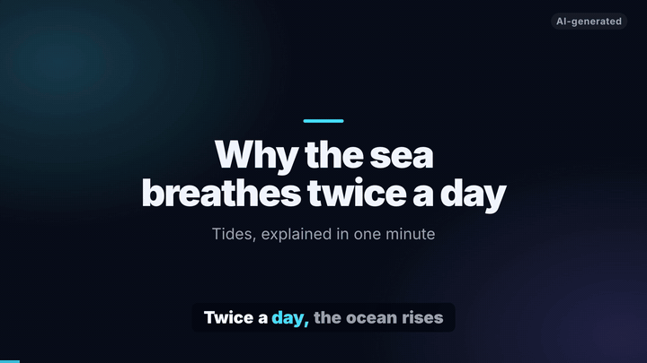
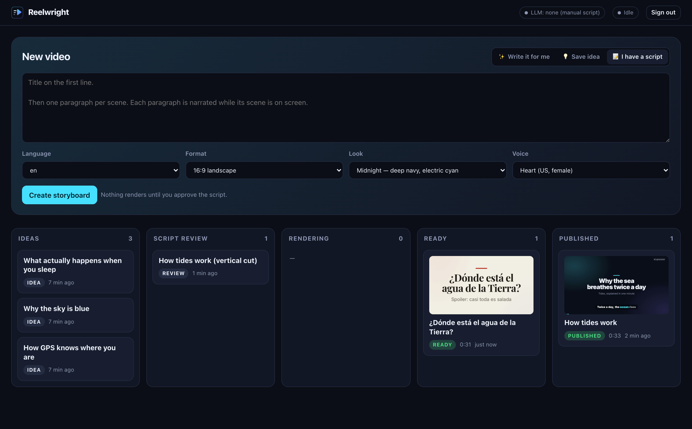
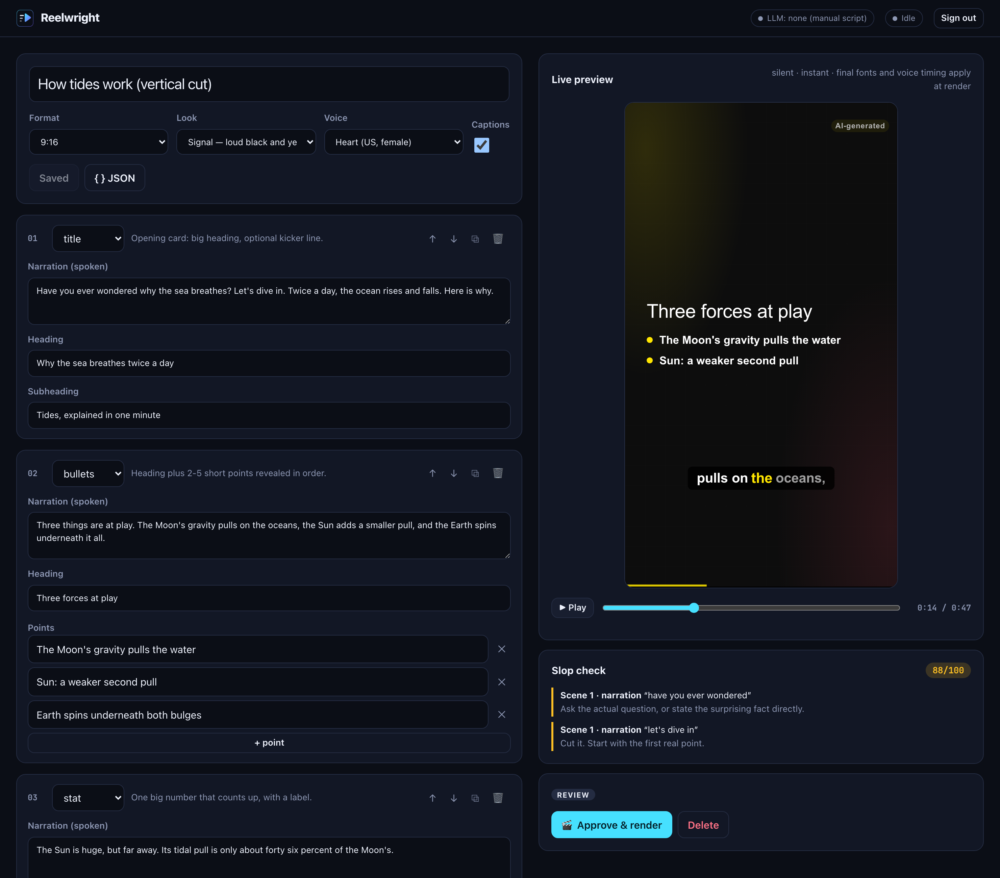

<div align="center">

<picture>
  <source media="(prefers-color-scheme: dark)" srcset="docs/media/wordmark-dark.png">
  
</picture>

### Type a topic. Get a narrated, captioned, animated video.

**Self-hosted AI video studio** · script → voice → captions → motion graphics → MP4<br>
Local voice, no per-video fees, a review step before anything renders, and AI disclosure built in.

[](https://github.com/Kuan-AI-com/reelwright/actions/workflows/ci.yml)
[](LICENSE)


<br>

<!-- Hostinger partner link: append &REFERRALCODE=<code> to the button URL. Docs: docs/deploy-hostinger.md -->
<a href="https://www.hostinger.com/docker-hosting?compose_url=https://raw.githubusercontent.com/Kuan-AI-com/reelwright/main/docker-compose.yml"></a>

<br><br>


&nbsp;


<sub>Both clips were rendered by Reelwright from the JSON files in <a href="examples/"><code>examples/</code></a>. No editing, no stock footage.</sub>

</div>

---

## What it does

```text
 "how tides work"  ──►  ✍️ script  ──►  👀 you review  ──►  🗣️ voice  ──►  💬 captions  ──►  🎞️ render  ──►  video.mp4 + .srt
                        (your LLM)      (edit scenes)       (local)       (word-level)     (headless)
```

- **Topic, script or JSON in.** An LLM drafts a scene-by-scene storyboard, or paste your own script, or write the JSON.
- **Real motion graphics.** Seven scene types: title, bullets, counting statistics, bar charts, quotes, side-by-side compare and outro. Three themes.
- **16:9, 9:16 and 1:1** for YouTube, Shorts, Reels, TikTok and LinkedIn.
- **Local text-to-speech** with [Kokoro](https://huggingface.co/hexgrad/Kokoro-82M) in English, Spanish, French, Japanese and Chinese. No voice API, no per-minute fees.
- **Word-highlighted captions**, burned in, plus an `.srt` file.
- **Editorial board:** Ideas → Script review → Rendering → Ready → Published. Nothing renders until a person approves the script.
- **Live preview.** Edit a scene and scrub the timeline in the browser before spending a render.
- **AI disclosure by default:** an on-screen label plus MP4 metadata, so you are covered for the [EU AI Act](docs/legal.md) and platform labels.
- **Deterministic rendering** with [HyperFrames](https://hyperframes.heygen.com): the same storyboard always produces the same video.
- **Slop check.** Every script is scored for the habits that make AI videos feel generic: stock openers ("in today's world…", "let's dive in"), hype words, "it's not X, it's Y", empty endings, numbers without a source, on-screen text that just repeats the voice. In the studio, the CLI (`reelwright lint`) and the LLM drafting loop, which rewrites once when it scores badly.
- **Agent-ready.** Ships [skills](skills/) so Claude Code and other coding agents can plan, write, fact-check and render videos for you.

## The studio





<sub>Left: write or edit scenes. Right: a live preview you can scrub, and the slop check with what to fix in each scene.</sub>

## Quickstart

### Docker (recommended)

```bash
curl -fsSLO https://raw.githubusercontent.com/Kuan-AI-com/reelwright/main/docker-compose.yml
echo "REELWRIGHT_PASSWORD=$(openssl rand -base64 18)" > .env
docker compose up -d
# → open http://localhost:8080
```

Everything is in the image: Chromium, ffmpeg, the voice model and fonts.

### From source

Requires Node 22+, ffmpeg and Python 3.10–3.13 (for the local voice).

```bash
git clone https://github.com/Kuan-AI-com/reelwright && cd reelwright
npm install
npx reelwright doctor                                       # checks ffmpeg, browser, voice, LLM
npx reelwright make --storyboard examples/how-tides-work.json
npx reelwright serve                                        # web studio on :8080
```

### Let an LLM write the script

```bash
export LLM_PROVIDER=anthropic LLM_API_KEY=sk-ant-...      # or openai | openrouter | ollama
npx reelwright make "why the sky is blue" --seconds 45 --aspect 9:16
```

| `LLM_PROVIDER` | Notes |
|---|---|
| `anthropic` | Default model `claude-opus-5-5`. |
| `openai` | Default model `gpt-4o-mini`. Also any OpenAI-compatible endpoint via `LLM_BASE_URL`. |
| `openrouter` | Set `LLM_MODEL`. |
| `ollama` | Fully local: nothing leaves your machine. Default model `llama3.1` at `localhost:11434`; change it with `LLM_MODEL` and `LLM_BASE_URL`. |
| `none` | Write the script yourself (`--text script.txt` or `--storyboard`). |

## Deploy to a server

Reelwright needs a **VPS**, not shared web hosting: rendering runs a headless browser and ffmpeg for minutes. Plan on **2 vCPU / 8 GB** as the minimum.

- **One click:** the *Deploy on Hostinger* button above opens Hostinger's Docker Manager with the compose file preloaded.
- **Any VPS:** `docker compose up -d`, with an optional Caddy HTTPS setup.

Full guide, sizing and hardening: **[docs/deploy-hostinger.md](docs/deploy-hostinger.md)**.

## A storyboard

```json
{
  "title": "How tides work",
  "aspect": "16:9",
  "theme": "midnight",
  "scenes": [
    { "type": "title", "heading": "Why the sea breathes twice a day",
      "narration": "Twice a day, the ocean rises and falls. The reason is a tug of war in space." },
    { "type": "stat", "value": 46, "suffix": "%", "label": "of the Moon's pull is what the Sun adds",
      "source": "Ratio of solar to lunar tidal force",
      "narration": "The Sun pulls too, with a bit less than half the Moon's tidal force." },
    { "type": "outro", "heading": "Two bulges, one spinning planet",
      "narration": "So the tide is not the water moving in. It is Earth turning through two bulges." }
  ]
}
```

Every field and limit: **[docs/storyboard.md](docs/storyboard.md)**.

## CLI

```text
reelwright make "<topic>"            draft with your LLM, voice, render
reelwright make --storyboard s.json  render a storyboard
reelwright make --text script.txt    title + one paragraph per scene, no LLM
reelwright draft "<topic>"           only write the storyboard (review, then make)
reelwright lint s.json              slop check: stock phrases, hype, unsourced numbers, pacing
reelwright serve                     web studio
reelwright doctor                    check the setup
reelwright voices                    list voices
```

Options: `--lang`, `--seconds`, `--aspect`, `--theme`, `--voice`, `--quality draft|looks|delivery`, `--no-captions`, `--no-voice`, `--out`, `--notes`.

## Use it from a coding agent

Copy the folders in [`skills/`](skills) into your agent's skills folder, for example `~/.claude/skills/` for Claude Code. Then ask:

> *"Make a 60-second vertical video explaining compound interest, in Spanish."*

| Skill | What it teaches the agent |
|---|---|
| [`reelwright`](skills/reelwright/SKILL.md) | The storyboard format, how to render, lint and check the result, the HTTP API. |
| [`video-storytelling`](skills/video-storytelling/SKILL.md) | Hook, turn and takeaway; beat templates for 15 s to 3 min; which visual fits which kind of information; vertical specifics. |
| [`video-script-doctor`](skills/video-script-doctor/SKILL.md) | Rewriting a script so it stops sounding AI-written: specific over generic, spoken over written, the phrases to cut. |
| [`video-fact-check`](skills/video-fact-check/SKILL.md) | Verifying every number and quote before render, and what to do when a claim can't be verified. |

The writing and fact-check skills work for any video tool, not only Reelwright. A running studio can also be driven over its [HTTP API](skills/reelwright/references/api.md).

## Honest limits

Reelwright is a good fit for **explainers, data stories and educational shorts**. It is not a fit for everything:

- **No AI-generated footage or avatars.** Visuals are typographic motion graphics and charts, not Sora-style clips or talking heads. That is deliberate: it is cheap, fast, deterministic and honest.
- **CPU rendering is not instant.** Expect a few minutes for a one-minute 1080p video on a small VPS, and one render at a time.
- **Five voice languages today.** Captions work in any language your LLM can write; the voice does not.
- **The LLM can be wrong.** That is why there is a review step. Check the facts before you approve.
- **No direct upload to YouTube or TikTok yet.** Download the MP4 and post it yourself.

## Legal & responsible use

- **[docs/legal.md](docs/legal.md):** AI labelling (EU AI Act Art. 50, YouTube, TikTok), voices and likeness, music rights, facts and sources, privacy. Not legal advice, but a good checklist.
- **[THIRD_PARTY_NOTICES.md](THIRD_PARTY_NOTICES.md):** every component and its license, including the GPL tools that run as separate programs in the Docker image.
- Videos you make are yours. Reelwright puts no license or watermark on them, apart from the AI-disclosure label, which you control.

## How it works

```text
storyboard.json ─► validate ─► Kokoro TTS (per scene, local) ─► timeline from real audio lengths
                 ─► HTML composition (themes + scene templates + captions + disclosure label)
                 ─► HyperFrames: headless Chromium seeks every frame ─► ffmpeg ─► MP4 + poster + SRT
```

The studio is a single Node process: built-in `node:sqlite` storage, one render queue and a vanilla-JS front end. No build step and no external database.

## Contributing

Issues and PRs are welcome. New scene types, themes and voice languages are the most useful contributions. See [CONTRIBUTING.md](CONTRIBUTING.md) and [SECURITY.md](SECURITY.md).

## License

[Apache-2.0](LICENSE). Built on [HyperFrames](https://github.com/heygen-com/hyperframes) (Apache-2.0) and [Kokoro-82M](https://huggingface.co/hexgrad/Kokoro-82M) (Apache-2.0).
